# Database Design (PostgreSQL / Supabase)

Principles: UUID PKs, `created_at/updated_at`, foreign keys everywhere, enum types for statuses, RLS on every table, migrations only via `database/migrations/` (Supabase CLI), no client-trusted scores.

## ER overview

```mermaid
erDiagram
  profiles ||--o{ user_roles : has
  profiles ||--|| user_preferences : has
  nursing_domains ||--o{ topics : contains
  topics ||--o{ topic_sections : has
  topics ||--o{ topic_references : cites
  sources ||--o{ topic_references : "is cited by"
  topics ||--o{ content_versions : versioned
  topics ||--o{ content_reviews : reviewed
  clinical_skills ||--o{ skill_steps : has
  clinical_skills ||--o{ competency_checklists : has
  competency_checklists ||--o{ competency_attempts : attempted
  questions ||--o{ question_options : has
  questions ||--|| question_explanations : explained
  questions ||--o{ question_references : cites
  exam_attempts ||--o{ exam_answers : contains
  questions ||--o{ exam_answers : answered
  scenarios ||--o{ scenario_nodes : has
  scenario_nodes ||--o{ scenario_choices : offers
  scenario_choices ||--o| scenario_outcomes : leads_to
  scenarios ||--o{ simulation_attempts : attempted
  medication_categories ||--o{ medications : groups
  medications ||--o{ medication_references : cites
  medications ||--o{ medication_reviews : reviewed
  profiles ||--o{ learning_progress : owns
  profiles ||--o{ bookmarks : owns
  profiles ||--o{ completed_topics : owns
  profiles ||--o{ study_sessions : owns
  profiles ||--o{ subscriptions : owns
  subscription_products ||--o{ subscriptions : sold_as
  subscriptions ||--o{ payment_events : logged
```

## Tables (additions to the brief's list marked +)

**Identity:** `profiles` (id = auth.users.id, display_name, country, experience_level, locale), `user_roles` (user_id, role enum, specialty[]), `user_preferences`.

**Curriculum:** `nursing_domains` (+`specialty` default 'adult_icu', slug, sort), `topics` (domain_id, slug, status enum, learner_level, est_minutes, current_version_id, last_reviewed_at, next_review_at, guideline_version_note), `topic_sections` (topic_id, kind enum per the 20-part template, body jsonb/markdown, sort), `topic_references` (topic_id, source_id, citation, pinpoint, what_was_independently_written), `content_reviews` (entity_type, entity_id, reviewer_id, decision, comments, reviewed_at), `content_versions` (entity_type, entity_id, version_no, snapshot jsonb, author_id, status), + `sources` (mirrors `source_register.csv`; licence_class enum GREEN/YELLOW/RED, last_checked), + `audit_log`.

**Skills:** `clinical_skills`, `skill_steps`, `competency_checklists`, `competency_attempts` (self-assessed or assessor-signed; `validated_by` nullable — online completion is *not* validated competency).

**Questions:** `questions` (stem, category enum, difficulty, topic_id, learning_objective, status), `question_options` (4 per question; `is_correct` hidden from clients via view), `question_explanations` (correct rationale + per-option rationale), `question_references`, `exam_attempts` (mode: topic/domain/random/timed/case, started_at, submitted_at, score computed server-side), `exam_answers`.

**Simulation:** `scenarios` (graph meta, status), `scenario_nodes` (patient state jsonb: vitals, labs, narrative), `scenario_choices` (node_id, text, kind: nursing_action | escalation | prescriber_decision, next_node_id, feedback), `scenario_outcomes`, `simulation_attempts` (path jsonb, score).

**Medications:** `medication_categories`, `medications` (generic name, class, mechanism, ICU indications, precautions, adverse effects, monitoring, administration safety, interactions, local-protocol warning; dose fields nullable and gated), `medication_references`, `medication_reviews` (pharmacist_id, decision).

**Learning:** `learning_progress`, `bookmarks`, `completed_topics`, `study_sessions`.

**Commercial:** `subscription_products`, `subscriptions` (provider ids, status, period end), `payment_events` (raw provider event, idempotency key; written by webhook only).

## Key constraints

- `topics.status = 'published'` requires a `content_reviews` row with `decision='approved'` by a non-author (trigger).
- Medications with dose fields set require `pharmacist_reviewed`.
- Exactly 4 options and exactly 1 correct option per question (constraint trigger).
- Indexes: FK columns; `topics(status, domain_id)`; `exam_answers(attempt_id)`; GIN full-text on topics/sections; `learning_progress(user_id, topic_id)` unique.

## Row Level Security strategy

- Default deny; RLS enabled on all tables.
- Published content readable by anon/learners via views that exclude drafts, reviewer comments and `is_correct`.
- Learner-private tables (`learning_progress`, `bookmarks`, `completed_topics`, `study_sessions`, `exam_*`, `simulation_attempts`, `competency_attempts`, `subscriptions`): `user_id = auth.uid()` for select/insert/update; no delete of exam records.
- Role checks via `SECURITY DEFINER` function `has_role(role)` reading `user_roles` (not JWT claims alone); roles never editable by the user.
- Authoring tables: author/reviewer/publisher/admin policies per `CLINICAL_GOVERNANCE.md`.
- Exam grading: client calls a server function/Route Handler; correct answers and scoring never sent to the client before submission; `payment_events` and `audit_log` insert via service role only.
- Tests (pgTAP or SQL scripts) for every policy are a Phase 1 acceptance criterion.
