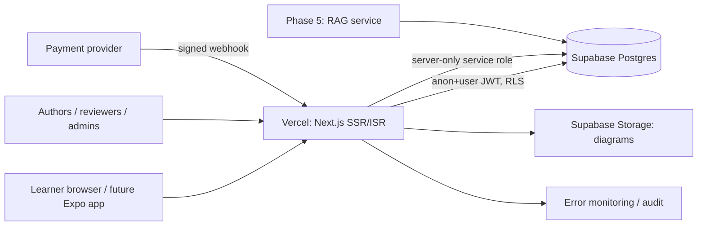

# Technical Architecture

## Stack (per brief)

Next.js (App Router) + TypeScript + Tailwind + shadcn/ui + Lucide · Supabase (Postgres, Auth, RLS, Storage, migrations) · Vercel · React Flow for scenario authoring · H5P selectively · Expo later (not before web is stable). Exact versions pinned at Phase 1 after checking licences/maintenance.

## Authentication

Supabase Auth (email+password, magic link; OAuth optional). Email verification required. Rate limits on auth and exam endpoints. Sessions via `@supabase/ssr` cookies; authorisation always re-checked server-side. Admin/reviewer accounts: MFA required.

## Authorisation / RLS

See `DATABASE_DESIGN.md`. Roles live in `user_roles`, checked in policies via `has_role()`. Service-role key exists only in server environment variables, never in client bundles.

## Content-management architecture

Content is **data in Postgres, not code**, so corrections need no redeploy. Authoring UI in the app (`/admin`) edits sections (structured blocks stored as JSON/Markdown). Public pages use ISR with on-demand revalidation when a version is published. Versions are immutable snapshots; publish = pointer change (`current_version_id`). Images in Storage with alt-text required and source/licence fields.

## Exam engine

Server-side only: start attempt → server selects/randomises questions → client receives stems/options without answer flags → submission graded on the server → explanations returned after submit. Timer enforced server-side (`submitted_at - started_at`). Question and option order randomised per attempt.

## Simulation engine

Custom, data-driven state machine; React Flow is the **authoring** canvas.

- `scenario_nodes` hold patient state (vitals, labs, narrative, available investigations); `scenario_choices` hold transitions with `kind` ∈ {nursing_action, escalation, prescriber_decision}.
- Runtime: `POST /api/sim/step {attemptId, choiceId}` validates that the choice belongs to the current node, appends to path, returns next node + feedback. Server-authoritative; scores stored server-side.
- Boundary rule: choices of kind `prescriber_decision` are shown as "request/communicate to prescriber" and are never scored as nursing actions.
- Validation at publish: no dead ends, all nodes reachable, at least one terminal node, every node has feedback.
- All patients synthetic; a lint step blocks identifiers.

## Subscription architecture

Provider TBD (decision needed; Stripe is the default assumption, but region/Saudi payment support — e.g., mada — must be checked). Webhook endpoint verifies signature, is idempotent (`payment_events.event_id` unique), and updates `subscriptions`; entitlement is read from the DB, never from the client. Free tier: selected topics; paid: full library/exams/sims.

## Security & operations

Validation with Zod on all inputs; CSP and security headers; rate limiting (Vercel/Upstash or Postgres-based); audit log for content and role changes; Supabase PITR/daily backups (plan-dependent — confirm), documented restore drill before launch; Sentry-type error monitoring; privacy policy/ToS; data minimisation (no patient data; learner PII limited to account data).

## Internationalisation / RTL

`next-intl` (or equivalent) with locale routing; logical CSS properties (`ms-`, `me-`, `ps-`) from day one; `dir` set per locale; content tables support translations (`*_translations` or `locale` column) added before Arabic rollout; clinical Arabic terminology reviewed by Saudi clinicians.

## Deployment

Environments: local (Supabase CLI) → preview (per PR, Supabase branch/staging) → production. CI (GitHub Actions): typecheck, lint, unit tests, RLS tests, Playwright smoke, a11y (axe). Migrations applied through CI. **No production infrastructure is created and no cost is incurred without your explicit approval.**

## AI assistant (Phase 5)

RAG over *published, approved* content only; chunks carry topic/version/source IDs; answers must cite retrieved chunks, say "not in the library" when unsupported, refuse patient-specific orders; per-user usage caps; no autonomous agents.
